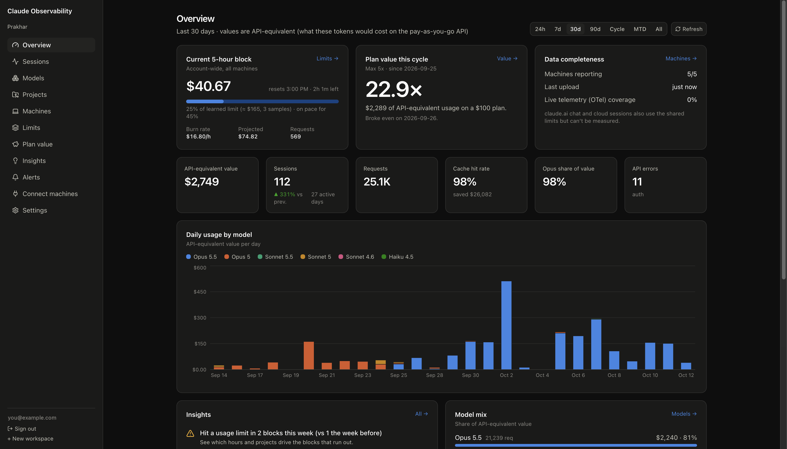
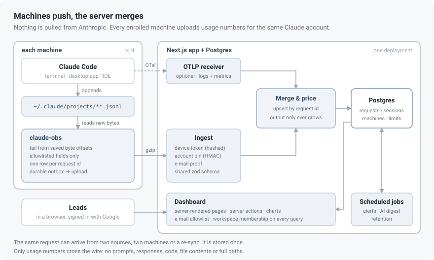
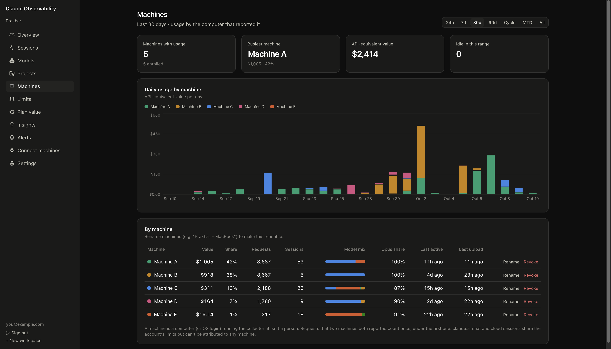
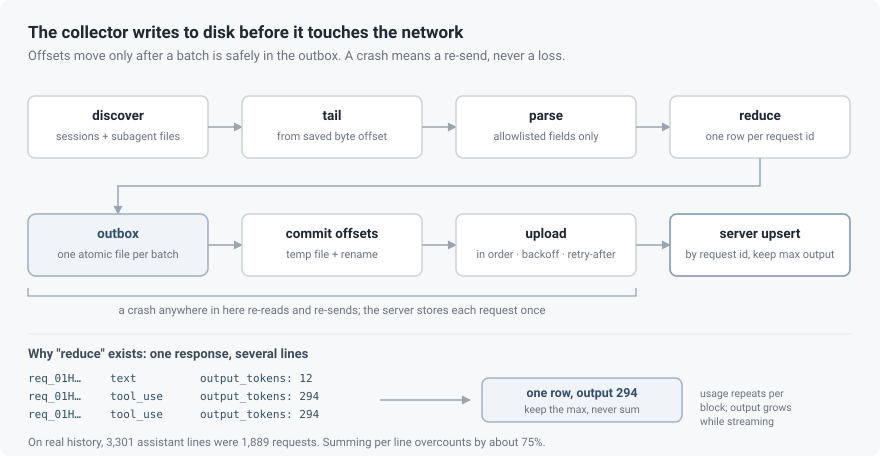
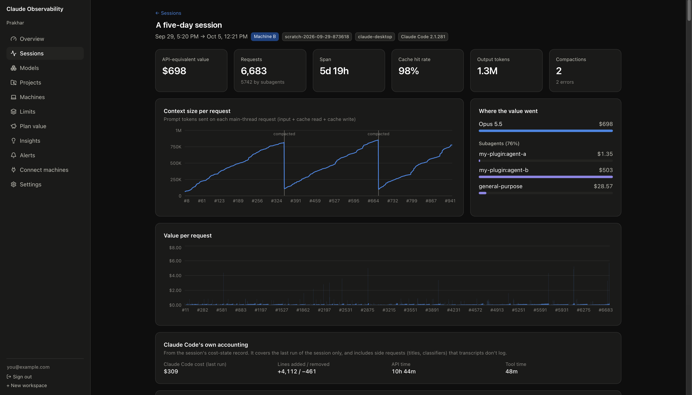

# Where does a Claude subscription's usage actually go?

A Claude Max subscription gives you a lot of Claude Code. It does not tell you
much about how you used it. `/usage` shows a percentage of the current window
and when it resets. That's the whole report: no history, no sessions or models,
and nothing across machines.

API customers get an Admin API with usage and cost reports. Subscribers get
nothing like it. Meanwhile the data that *would* answer the question sits in
plain sight, in Claude Code's session files, spread across every laptop,
desktop and remote dev box you use it on.

So I built [**claude-observability**](https://github.com/FirePing32/claude-observability):
a small collector, [`claude-obs`](https://www.npmjs.com/package/claude-obs), that
runs on each machine, and a Next.js dashboard that turns what the collectors
upload into account-level analytics. It's about 2,000 lines of TypeScript for
the collector (no runtime dependencies) and 6,500 for the app, plus a small
shared package that both depend on.

The interesting parts weren't the charts. They were:
- getting a number you can trust out of files that were never meant to be read
- keeping prompts and code on the machine
- running a background process on computers you don't control

---

## Getting started

- **Source:** [github.com/FirePing32/claude-observability](https://github.com/FirePing32/claude-observability), MIT licensed
- **Collector:** [`claude-obs` on npm](https://www.npmjs.com/package/claude-obs), Node 20+

Deploy the dashboard yourself (the README walks through it), sign in, create a
workspace for your Claude account, and generate an enrollment code. Then, on
every machine that runs Claude Code with that account:

```sh
npm install -g claude-obs
claude-obs login --code XXXX-XXXX --server https://<your-dashboard>
claude-obs sync            # uploads your full history the first time
claude-obs install-agent   # keeps it up to date in the background
```

Want to see exactly what leaves the machine before enrolling?
`claude-obs sync --dry-run` prints it and sends nothing.

---

## The problem

The questions are simple to ask:

- **Am I about to hit the 5-hour limit?** And how close did I get yesterday?
- **What is using it?** Which sessions, which projects, which models? Is Opus
  quietly doing work Sonnet could do?
- **Is the plan worth it?** What would the same tokens have cost on the
  pay-as-you-go API?
- **Is anything missing?** Has a machine stopped reporting? Did we hit a limit
  that the tracked usage doesn't explain?

The constraints are what make it a project:

1. **There is no API to pull from.** The only source is local files, on each
   machine, in a format Anthropic doesn't document and changes at will.
2. **The account is the unit.** Limits apply to the account, not to a machine.
   A dashboard that shows one laptop's usage answers the wrong question.
3. **Nothing sensitive leaves the machine.** The session files hold every
   prompt, every response, every file Claude read. The collector must upload
   numbers and nothing else, and that has to be provable rather than promised.
4. **No credentials.** The collector must never touch the Claude login token.

### What the answers look like



That's the overview for my account over the last 30 days. Each question above
gets a tile:

- **The 5-hour limit.** The current block has used $40.67 of value with two
  hours to go. That's 25% of this account's *learned* limit (about $165, from
  three real limit hits). At the current burn rate of $16.80 an hour it will
  reach about 45% by the reset.
- **Is the plan worth it?** $2,289 of API-equivalent usage on a $100 plan this
  cycle: 22.9×. It broke even the day after renewal.
- **What is using it?** Opus accounts for 98% of the value. The daily chart also
  shows the switch from Opus 5 to Opus 5.5 in late September, without anyone
  having to remember when it happened.
- **Is anything missing?** All five machines are reporting. But telemetry
  coverage is 0%, so the totals are a few percent low, and claude.ai chat isn't
  measured at all. The page says so instead of hiding it.

Below the tiles, the first insight was the one that started the project: *hit a
usage limit in 2 blocks this week, vs 1 the week before*.

---

## The shape of the system



It's a **push** model. Each machine runs `claude-obs`, which reads the bytes
Claude Code appended to its session files since the last run. It reduces them
to usage records and uploads them. The server merges uploads from every machine
into one account, prices each request, and serves the dashboard.

A **workspace** is one Claude account. Machines enroll into a workspace, and
everything shown is account-wide. There is deliberately no per-person view: the
goal is the right totals for the account, not a leaderboard.



Machines are the one breakdown the dashboard does offer, because a silent or
misconfigured collector is the most likely reason for wrong totals. For each
machine (names anonymized here), it shows:
- its share of the value
- its model mix and Opus share
- when it was last active and last uploaded

A request reported by two machines counts once, under the first one.

The repo is an npm workspace with three packages:

- `packages/shared`: the wire schema (zod) and the **price book**. The
  collector validates what it sends with the same schema the server validates
  what it receives, so the two can't drift.
- `packages/cli`: the collector, bundled into a single file with `tsup`.
- `apps/web`: the Next.js 16 app. It holds the ingest endpoints, the dashboard,
  the alerting and the database migrations.

---

## The collector

### Session files are undocumented, so parse an allowlist

Claude Code writes one JSON object per line to
`~/.claude/projects/<project>/<session>.jsonl`, plus a `subagents/` folder per
session for subagent runs. There are a couple of dozen record types: assistant
messages, titles, compaction markers, turn durations, Claude Code's own cost
snapshots, permission-mode changes and more. New ones appear between releases.

The parser dispatches on `type` and handles only the records it understands. It
builds every output record **field by field from explicit paths**: no object
spreading, no copying of `message`. Anything unknown is counted, not parsed. The
dashboard shows those counts under *Data quality*, so a format change shows up as
a number going up rather than as silently wrong totals.

### One response, several lines

The first real surprise came from counting before writing any parser logic.



Claude Code writes **one line per content block** of a response, and repeats
the response's `usage` object on each. A reply with a text block and a tool call
is two lines with identical token counts. Sum them and you double-count. On my
own history, 3,301 assistant lines turned out to be 1,889 distinct requests.
Naive summing overcounted by about 75%.

It's subtler than duplication. For 39 of those requests, `output_tokens`
*differed* between lines, and the last line was always the largest. Those are
streaming updates. So the rule is: group by `requestId` and **keep the max,
never sum**. The collector re-sends a request only if its output grew, which
keeps a live session accurate while a response is still streaming.

The server applies the same rule, so an out-of-order batch can't lower a value:

```ts
// never let a concurrent, staler write lower the final streamed output
output: sql`greatest(${schema.apiRequests.output}, excluded.output)`,
```

Other records need their own handling. Lines with `model: "<synthetic>"` are
not requests at all. They're API errors and usage-limit notices that Claude Code
writes into the transcript. The collector classifies them locally into a
category (`prompt_too_long`, `rate_limit`, a five-hour or weekly limit and so
on) and uploads only the category, never the text.

### Tail bytes, not files

Session files grow to tens of megabytes. Re-reading them on every change would
be wasteful, so the collector keeps a byte offset per file, plus its device and
inode numbers:

- It reads from the offset to EOF and consumes **complete lines only**. A
  trailing line without a newline is still being written, so it waits for the
  next pass.
- It decodes each line from bytes on its own, so a multi-byte character split
  across a read chunk is never mangled.
- If the inode changed or the file shrank, the file was replaced, so it reads
  from zero. That's safe because the server deduplicates.

In watch mode it uses recursive `fs.watch` with a debounce, plus a full rescan
every 15 minutes as a safety net for missed events.

### Write to disk before touching the network

The order of operations is the whole reliability story:

1. Parse new lines into batches.
2. Write each batch to an **outbox** directory, one file per batch, via temp
   file and rename.
3. Commit the new offsets to `state.json`, the same way.
4. Upload the outbox, in order, deleting each file only after the server
   accepts it.

A crash between steps 2 and 3 means the lines are read again and queued twice.
The server stores each request once, so that's harmless. A crash anywhere else
leaves the batch in the outbox for the next run. A laptop that's offline for a
week simply builds up a queue. **Every failure is a re-send, never a loss.**

Upload failures are classified:
- **Network errors, 5xx and 429** back off and retry, honouring `Retry-After`.
- **401 (token revoked)** stops the agent and asks for a new login.
- **422 (schema rejected)** moves that one batch to a quarantine folder with
  the reason, so a single bad record can't block the queue forever.

### Privacy is a test, not a promise

"We only upload usage" is easy to write in a README. The repo enforces it
three ways:

- **Field-by-field builders**, as above. There's no code path that copies an
  object from the transcript into the output.
- **A canary test.** The fixtures plant marker strings in message content,
  e-mail addresses and file paths. The test fails if any of them appear anywhere
  in the serialized upload.
- **`claude-obs sync --dry-run`** prints exactly what would be sent, so anyone
  can check for themselves before enrolling.

What does go up: model, timestamps, token counts (with the five-minute and
one-hour cache writes separated), effort, entry point, subagent type, the
project folder's *basename* (or a salted hash of it), git branch, and session
titles (which can be switched off).

### Corporate networks break naive HTTPS

The first machine outside my own failed immediately:
`SELF_SIGNED_CERT_IN_CHAIN`. Security agents like Netskope and Zscaler intercept
HTTPS and re-sign it with a company root certificate. The OS trusts that root.
Node, by default, doesn't: it ships its own CA bundle.

Telling every user to set `NODE_EXTRA_CA_CERTS` would be a support burden. So
the collector trusts the operating system's store automatically, the way a
browser does:

- **Newer Node (22.19+, 24.5+):** `tls.setDefaultCACertificates` merges the
  system certificates in-process.
- **Older Node on macOS:** it exports the System keychain and Apple's roots
  with `/usr/bin/security`, caches the bundle for a week, and re-launches itself
  once with `NODE_EXTRA_CA_CERTS` pointing at it. Node reads that variable only
  at startup, hence the re-exec.
- **Older Node on Linux:** it points at the distribution's CA bundle the same
  way.

One more trap: a background service doesn't inherit your shell's environment.
Proxy and certificate variables that work in a terminal are simply absent under
launchd. The agent installer copies them into the service definition.

### The background agent

`claude-obs install-agent` runs `sync --watch` as a launchd agent on macOS, a
systemd user unit on Linux, or a Task Scheduler job on Windows, at low priority.

A PID lock file keeps it to one instance. The lock is released on exit and on
SIGINT, SIGTERM and SIGHUP, and a lock left by a dead process is detected and
replaced. Running `claude-obs sync` by hand while the agent is up just nudges the
running instance.

---

## The server

### Idempotent ingest from two sources

Session files are not the whole truth. Claude Code also makes small side
requests, such as generating session titles and running classifiers, that never
reach the transcript. That's 5–10% of usage.

Claude Code can export **OpenTelemetry** events, though, and its `api_request`
event includes those side requests and latency. So the app has an OTLP/HTTP
receiver too, and `claude-obs otel --install` merges the right settings into
Claude Code's config, with a backup.

Both sources describe the same requests, so everything is an **upsert keyed on
workspace and request id**:

- Transcript token counts win, because they carry the five-minute and one-hour
  cache split that OTel collapses into one number.
- OTel-only fields like duration survive a later transcript upload.
- `output` only ever grows.

Each row records which sources have seen it. That's what *Data quality* shows:
seen by both, by transcripts only, or by telemetry only.

### Pinning machines to one account

A workspace must only ever contain one Claude account's usage. If someone
enrolled a machine logged into a different account, every total would be
silently wrong.

The collector reads the account UUID from Claude Code's local config and sends
`HMAC-SHA256(salt, accountUuid)`, never the UUID itself. The salt is
**per workspace**, handed out at enrollment, so every machine on the account
produces the same hash. With a per-machine salt, "is this the same account?"
would be unanswerable. The first upload pins the workspace to that hash, and
uploads from any other account are rejected with a 409.

### Who may upload

Machines enroll with a short **enrollment code** that a workspace owner
generates. Codes are stored hashed, expire, and have a use limit. There's also
a device-code flow: the CLI prints a code, and an owner approves it in the
browser after seeing the machine's name, OS and IP. Either way, the machine
gets a random 256-bit token. The server stores only its SHA-256, and each
machine can be revoked on its own.

On top of that sits an **e-mail check**. A workspace can require that machines
are logged into Claude with an approved e-mail address. The collector never
sends the address. It sends `sha256("claude-obs-email-v1:" + email)`, and the
server compares it against the owners' addresses and discards it.

That's not cryptographic proof, since the machine reports its own e-mail. It
stops mistakes and casual misuse. The enrollment code and token remain the real
lock.

### Who may look

Sign-in is Google OAuth through Better Auth, restricted by an e-mail allowlist.
The check runs in two database hooks: when an account is created and whenever a
session starts. Removing someone takes effect at their next sign-in rather than at
some later cleanup. Every page, query and server action checks workspace
membership.

The most useful security changes in the project were *removals*. The first
version had invites, so a member could add someone, and public share links for
read-only dashboards. Both were convenient. Both meant the set of people who
could see the data was decided by whoever was signed in, not by the allowlist.
I removed them. Now the allowlist is the only door.

### Reconstructing the 5-hour blocks

Anthropic describes subscription limits as five-hour sessions that start with
your first message. It doesn't publish the exact rules, so the dashboard
**models** them:

```ts
if (!cur || e.ts >= cur.end) {
  const start = Math.floor(e.ts / HOUR) * HOUR;  // round down to the hour
  cur = { start, end: start + BLOCK_MS, /* … */ };
}
```

A block starts at the first request after the previous block expired, and lasts
five hours. Within the active block, the dashboard shows value used, burn rate
per hour and a projection to the reset.

What it can't know is the size of the limit. So it **learns** one. Every time
the account hits a five-hour limit, the value tracked in that block up to the
hit is a sample. The median of those samples is the account's learned ceiling,
and the 10th percentile is a conservative one.

The same data catches something useful: if a limit is hit while tracked usage
is well below the conservative ceiling, something the collector can't see was
using the account. Usually that's claude.ai chat. The dashboard flags it as
*unseen usage* rather than pretending the numbers are complete.

### Value, not cost

On a subscription, nothing is billed per token. So every dollar figure is
**API-equivalent value**: what the same tokens would have cost on the
pay-as-you-go API. It's computed from an explicit price book: input, output,
cache read, five-minute and one-hour cache writes, web search, and multipliers
for fast mode and US-only inference.

Cache prices are listed per model, not derived from a ratio, because the ratios
differ between models. An unknown model is stored and counted as *unpriced*, not
guessed. Divide the cycle's value by the plan price and you get the number most
people actually want: how many times over the plan paid for itself.

### Insights and alerts

Insights are rules, not a model:
- limit pressure
- a drop in cache-hit rate
- runaway sessions
- Opus-heavy weeks
- silent machines
- unseen usage

An optional weekly digest sends **aggregates only** to Claude for a
written summary. No sessions or titles go out.

Alerts go to Slack, a webhook or e-mail, deduplicated per rule and per block.
My hosting tier allows only daily cron jobs, which would make "you're at 90% of
the block" useless. So alerts are also evaluated **after every upload**. Real
activity triggers the check, and the daily job only has to catch the absence of
activity: a machine that went silent.

---

## How it was built

### Plan first, and write down the decisions

The project started as a plan document, not code. The questions that shaped it
were answered before any code was written:

- **Push or pull?** Push, because there is nothing to pull from.
- **Per-person or account?** Account, because limits are per account.
- **What counts as truth?** One row per request id, merged from every source.

Those three answers decided most of the schema.

### Measure the data before writing the parser

The 75% overcount wasn't a hypothesis. It came from counting lines against
unique request ids in a real 44 MB history before the parser existed. The same
pass found the streaming growth, the subagent folders and the synthetic error
lines. Every one of those would otherwise have been a bug report.

### Verify against something independent

The collector's totals were checked against a separate script written from
scratch. They agreed to within one request: $235.18 against $235.27, a request
made while both were running.

The obvious second check turned out weaker than expected. Claude Code records its
own cost summary per session, but only for the **last process run**. Resuming a
session resets it, and it includes the side requests transcripts never see.
Single-run sessions matched to the cent. Resumed ones didn't, for good reasons. So
the dashboard shows that figure as *Claude Code's own accounting (last run)*
rather than as a pass/fail check.



The session above shows why. It ran for almost six days across several resumes:
6,683 requests and $698 of tracked value. Claude Code's own record says $309,
because it covers only the last run.

The same page shows two things you can't see from inside Claude Code:
- **Context size per request.** It climbs past 800K tokens until a compaction
  drops it back to about 100K, twice.
- **Subagents.** They made 5,742 of the 6,683 requests and account for 76% of
  the value.

### Let the rollout find the bugs

The first real machines found two problems no test had:

- **The corporate TLS issue above.** Version 0.1.3 added clearer network
  errors and automatic system-certificate trust.
- **A queue stuck on an old version.** Version 0.1.4 made the e-mail proof
  mandatory. Machines that upgraded still had batches queued by 0.1.3 without
  it, and the server answered each one with *426, please upgrade*, forever.
  The durable outbox had faithfully preserved batches that could never be
  accepted. Version 0.1.5 upgrades queued batches as it sends them. It fills in
  the proof from the machine's current login, but only when the batch's account
  hash matches that login.

The lesson generalizes: **a durable queue is also a durable copy of your old
wire format.** Plan for draining it.

### The stack

- **Collector:** TypeScript on Node 20+, bundled with `tsup` into one file.
  `node:util` `parseArgs`, built-in `fetch`, zod bundled in. No runtime
  dependencies, no native modules, and no telemetry about the CLI itself.
- **App:** Next.js 16 (App Router, server actions, React 19), Better Auth with
  Google, Drizzle ORM on postgres.js, Tailwind CSS 4, Recharts and Vitest.
- **Data:** managed Postgres. Raw facts are kept for 13 months and the ingest
  log for 90 days.

---

## What it can't see

Being explicit about this matters more than any chart:

- **claude.ai chat, the desktop app's chat and cloud Claude Code sessions** use
  the same limits but leave no local files. The unseen-usage flag is the only
  evidence of them.
- **History has a shelf life.** Claude Code deletes session files after 30 days
  by default (`cleanupPeriodDays`). Anything older than that on a machine
  enrolled late is gone.
- **Without OpenTelemetry, totals are 5–10% low** because of the side requests.
- **The five-hour blocks are a model.** They match the documented behaviour,
  not a published specification.

The natural next step closes the biggest gap. Claude Code passes the account's
official five-hour and weekly utilization to the status line script, as a
percentage with a reset time. That's Anthropic's own meter, covering every
surface including chat. The collector could record it without touching
credentials, and the dashboard could then show "62% left, resets at 3 pm" instead of a
learned estimate.

---

## Five things worth knowing

1. **Count before you parse.** Undocumented formats lie by repetition. The
   biggest correctness bug was visible in a one-line count.
2. **Make every operation idempotent, then stop worrying.** One upsert key made
   crashes, re-syncs, two machines and two data sources the same non-event.
3. **Write to disk before the network, and plan to drain the queue.** Durability
   preserves your mistakes as faithfully as your data.
4. **Privacy you can't test is a claim.** A canary string in a fixture is
   cheaper than any amount of care.
5. **Removing features can be the security fix.** Invites and share links were
   the two ways around the allowlist. Deleting them did more than any check could.

The code is on GitHub: [**FirePing32/claude-observability**](https://github.com/FirePing32/claude-observability).
MIT licensed. The collector is on npm as [`claude-obs`](https://www.npmjs.com/package/claude-obs).

It's not affiliated with Anthropic. "Claude" and "Claude Code" are Anthropic's
trademarks. If you find a place where the numbers or the reasoning above are
wrong, open an issue.
